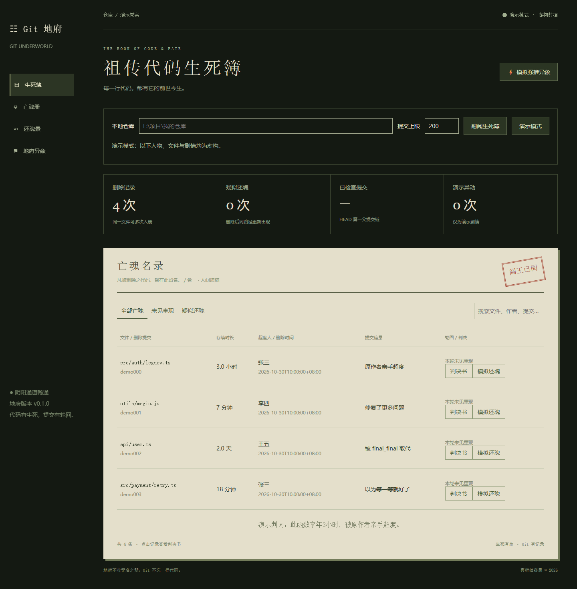
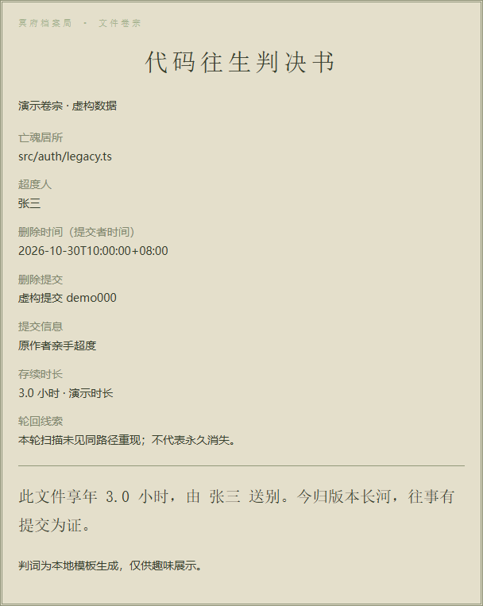

# Git 地府 · git-underworld

**把 Git 仓库翻成一本《祖传代码生死簿》。**

哪些文件被删了？谁动的手？活了多久？后来有没有重新出现？Git 地府读取本地 Git 历史，把这些记录整理成亡魂册，还能为每条记录生成可截图的「代码往生判决书」。

这是一个 **Windows 本地运行的只读工具**：在浏览器里操作，由本机 Python 服务分析仓库，正常使用不上传代码、不调用外部 AI 服务。当前分析粒度是**文件**，尚不支持识别文件内部被删除的函数或代码片段。

[快速开始](#快速开始) · [怎么使用](#怎么使用) · [功能与边界](#功能与边界) · [常见问题](#常见问题) · [开发文档](docs/technical-notes.md)

## 看看效果

下图为**内置演示模式**，人物和记录均为虚构；真实分析沿用同一界面，并隐藏模拟还魂与强推剧情。



<details>
<summary>查看「代码往生判决书」示例</summary>



</details>

## 快速开始

### 1. 准备环境

安装 **Python 3.11 或以上版本**、**Git for Windows**，确保已加入 PATH。打开 PowerShell，检查两条命令都能输出版本号：

```powershell
python --version
git --version
```

当前已在 Windows + Python 3.13 上验证。运行不需要 Node.js、数据库或 API Key。

### 2. 下载并安装

在你想存放项目的目录打开 PowerShell，依次执行：

```powershell
git clone https://github.com/xiaoyuaxiayu/git-underworld.git
cd git-underworld
python -m venv .venv
.\.venv\Scripts\python.exe -m pip install -r requirements.txt
```

仓库目前为私有：下载需要仓库访问权限。已有源码的用户在项目目录执行最后两条命令即可。首次安装依赖需要联网；这里直接使用虚拟环境的 Python，无需执行激活脚本。

### 3. 启动并打开页面

```powershell
.\start.bat
```

看到 `Uvicorn running on http://127.0.0.1:8765` 后，在浏览器打开 **[http://127.0.0.1:8765](http://127.0.0.1:8765)**。

保持启动窗口打开。以后使用时，双击项目里的 `start.bat` 即可启动，再打开上述地址；在启动窗口按 `Ctrl+C` 停止服务。

## 怎么使用

### 先看演示，不需要准备仓库

打开页面默认进入「演示模式」。你可以搜索记录，点击「判决书」，体验「模拟还魂」和「模拟强推异象」。这些操作只改变页面中的虚构数据，不会操作真实 Git 仓库。

### 分析一个真实示例仓库

想验证真实扫描，又不想先用自己的项目？保持服务运行，在项目目录**另外打开一个 PowerShell 窗口**，执行：

```powershell
.\.venv\Scripts\python.exe scripts/create_demo_repo.py
```

脚本会新建 `demo-repository`，并在终端打印它的完整路径。**复制输出的路径，粘贴到页面的「本地仓库」输入框，点击「翻阅生死簿」。**

你应该看到：

| 检查项 | 预期结果 |
| --- | --- |
| 模式 | 真实分析 · 本地只读 |
| 已检查提交 | 6 / 6 |
| 删除记录 | 2 条 `中文 空格.txt` |
| 存续时长 | 两条记录各为 1 小时 |
| 疑似还魂 | 较早的删除记录标记疑似还魂，较晚一条未见重现 |
| 重命名 | `旧 文件.txt` → `新 文件.txt` 不生成删除记录 |

示例提交信息中故意带有一段 HTML 测试字符串，用来验证安全显示；页面会把它作为普通文字展示。

如果提示目标已经存在，直接使用之前生成的目录即可；脚本不会覆盖旧目录。也可以指定一个**尚不存在**的新目录：

```powershell
.\.venv\Scripts\python.exe scripts/create_demo_repo.py "$PWD\另一个演示仓库"
```

### 分析自己的仓库

1. 找到电脑上已有的 Git 仓库，例如 `D:\Projects\我的项目`。输入的是**本地目录**，不是 GitHub 网址。
2. 将完整路径填入「本地仓库」，不加外层引号；支持中文和空格。
3. 保持「提交上限」为默认的 `200`，点击「翻阅生死簿」。
4. 先查看上方扫描说明：HEAD 哈希、已检查数量、实际区间，以及是否截断、浅克隆或只返回部分结果。
5. 在亡魂名录中查看记录；搜索框支持文件路径、作者、提交信息和短哈希。用「未见重现」「疑似还魂」筛选结果。
6. 点击记录或「判决书」，查看完整信息。可直接截图，也可使用「打印 / 保存 PDF」打开浏览器打印功能。

输入框和结果字段的含义：

| 字段 | 含义 |
| --- | --- |
| 提交上限 | 从 HEAD 沿第一父提交链选择最近多少次提交；默认 200，可填 1–1000 |
| 超度人 | 删除提交中记录的作者 |
| 删除时间 | 删除提交的提交者时间，不是你电脑上手动删除文件的时间 |
| 存续时长 | 能追溯到创建提交时，计算创建至删除的时间差；无法可靠追溯时显示「未知」 |
| 疑似还魂 | 删除后，同一路径在后续已扫描提交中再次出现；不保证内容一致 |
| 未见重现 | 本次扫描内未看到同路径重现，不代表文件永久消失 |

每次删除独立入册：一个文件删除、重建、再删除，会产生两条记录。「演示模式」按钮可以切回虚构数据。

## 功能与边界

| 能力 | 当前状态 |
| --- | --- |
| 本地 Git 文件删除历史、作者、时间、信息和哈希 | 已支持 |
| 可追溯的文件存续时长、同路径疑似还魂 | 已支持 |
| 搜索、筛选、往生判决书 | 已支持；趣味判词使用本地模板 |
| 重命名排除 | 排除 Git 识别出的重命名；同时大幅改写可能被识别为删除与新增 |
| 删除函数或文件内代码片段 | 尚不支持 |
| 实际恢复文件、回滚提交 | 尚不支持；真实模式只读 |
| 真实强推检测 | 不支持；警报仅为演示剧情 |
| 分享网址让别人分析其本地仓库 | 不支持；每位使用者需要在自己的电脑启动工具 |

默认只看 **HEAD 的 first-parent 历史**：从当前提交一路沿第一个父提交向前看；遇到合并提交时，只比较它相对第一父提交带来的变化，不逐一遍历支线内部历史。未提交的工作区删除不入册。

浅克隆、扫描数量上限和超时会影响结果完整性。详情见 [分析规则与安全边界](docs/technical-notes.md#分析规则)。

## 常见问题

| 遇到的情况 | 怎么处理 |
| --- | --- |
| `python` 或 `git` 不是可识别命令 | 安装对应程序并加入 PATH，然后重新打开 PowerShell |
| 提示缺少 `fastapi` 或 `uvicorn` | 在项目目录重新执行安装步骤中的 `pip install -r requirements.txt` 命令 |
| 浏览器打不开页面 | 确认启动窗口仍在运行且没有报错，再访问 `http://127.0.0.1:8765`；不要直接双击 `dist/index.html` |
| 提示 8765 端口已被占用 | 先查看该地址是否已有 Git 地府运行；同一时间只启动一份服务 |
| 提示「不是 Git 仓库」 | 检查输入路径；普通源码目录或下载的 ZIP 不一定包含 Git 历史 |
| 提示「仓库尚无提交」 | 该仓库还没有可分析的提交；先使用示例仓库体验 |
| 没有删除记录 | 检查是否有已提交的文件删除、是否位于当前 HEAD 的扫描范围，并清空搜索与筛选 |
| 存续时长显示「未知」 | 创建起点可能在扫描范围外，或历史不完整、提交时间倒序；可适当增加提交上限再试 |
| 提示浅克隆、截断或部分结果 | 当前结果仅代表已检查范围，不能当作整个仓库的完整历史 |
| Git 命令超时 | 降低提交上限重试；默认单命令超时 5 秒，总扫描预算 45 秒 |
| Git 拒绝不同用户拥有的仓库 | 使用仓库所属的 Windows 用户启动服务；工具不会自动修改 Git 信任配置 |

**会修改我的仓库吗？** 分析器只读，不恢复文件、不切换分支、不推送、不修改 Git 配置。演示仓库生成器是单独的脚本，只会向它新建的示例目录写入内容。

**别人能打开我的页面吗？** 服务只监听 `127.0.0.1`，该地址只对运行服务的电脑有效。获得代码访问权限的人可以在自己的电脑按上面的步骤安装使用。

## 开发与验证

前端源码位于 `frontend/`，后端位于 `backend/`，由 FastAPI 直接提供页面，无前端构建步骤。`dist/` 是旧原型存档，当前服务不加载它。

已完成 9 项后端测试及浏览器交互验证。超大仓库压力、其他浏览器和系统打印流程尚未完整验证。

- [开发说明、分析规则与安全实现](docs/technical-notes.md)
- [实际测试结果与未验证项](TEST_RESULTS.md)
